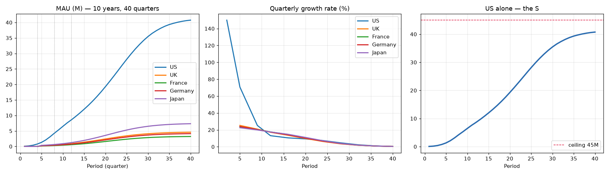

# S-Curve MAU Model

`S_Curve_Parameter_Search.ipynb` — the original 3-year parameter search plus a
new **Ten Year** section at the bottom.

## The Ten Year cell

Extends the horizon from 12 periods to **40 periods (10 years, quarterly)** and
shapes the path as an S-curve: slow launch, steep middle, flattening top.

Saturation is **derived from the UMG2 Video P&L model** (v135MK, sheet
"MAUs - End of Year Targets"), not assumed. Section 2 of the cell replicates
that workbook's MAU build and extends it to 2036.

Exit-quarter MAUs (millions), `CEILING_BASIS = "multiple"`:

| Year | Period | US | UK | France | Germany | Japan |
|-----:|-------:|-----:|-----:|-------:|--------:|------:|
| 1 | 4 | 0.78 | — | — | — | — |
| 2 | 8 | 4.27 | 0.45 | 0.28 | 0.39 | 0.62 |
| 3 | 12 | 8.58 | 0.90 | 0.56 | 0.77 | 1.24 |
| 4 | 16 | 11.91 | 1.29 | 0.80 | 1.08 | 1.73 |
| 5 | 20 | 14.41 | 1.56 | 0.96 | 1.30 | 2.06 |
| 6 | 24 | 16.16 | 1.73 | 1.07 | 1.43 | 2.26 |
| 7 | 28 | 17.27 | 1.84 | 1.13 | 1.51 | 2.38 |
| 8 | 32 | 17.93 | 1.90 | 1.17 | 1.56 | 2.45 |
| 9 | 36 | 18.30 | 1.93 | 1.19 | 1.59 | 2.50 |
| 10 | 40 | 18.50 | 1.95 | 1.20 | 1.60 | 2.52 |

Years 1–3 are unchanged: the existing targets at periods 4, 8 and 12 are still
hit to within 0.1%.

## How saturation is derived

The P&L model builds MAUs as `SOM x %Aware x %Converted`, and carries `%Aware`
only to 2032. It gets there in two stages: three logistic years
(`aware_max / (1 + exp(-1.5 * (year - midpoint)))`), then its own
extrapolation, in which the awareness growth rate keeps decaying at the rate it
was already decaying — the `RRI(1, g[y-3], g[y-2])` term, which lags by a year.

Section 2 reruns that recursion out to 2036 and **asserts the replication
against the workbook's own 2032 cells** before anything depends on it (matches
to 6 decimal places for all five countries). The result:

| | Y3 (workbook) | 2036 | Terminal multiple |
|---|---:|---:|---:|
| US | 6.76 | 14.78 | 2.19x |
| UK | 0.90 | 1.94 | 2.16x |
| France | 0.56 | 1.19 | 2.13x |
| Germany | 0.76 | 1.58 | 2.08x |
| Japan | 1.05 | 2.14 | 2.03x |

`CEILING_BASIS` chooses how to apply that:

* `"multiple"` (default) — keep this notebook's committed Y1–Y3 targets and
  grow them by the workbook's terminal multiple.
* `"absolute"` — use the workbook's own 2036 figure outright. Use this if the
  workbook, not the notebook, is the source of truth for levels.

The two agree closely for UK/France/Germany/Japan. They differ for the US
(18.50M vs 14.84M at Year 10), because this notebook's Year-3 target is ~27%
above the workbook's 2029.

## Non-US targets lead the workbook by a year — intentional

The US lines up on the calendar: notebook period 12 is the end of year 3, and
its 8.574M target sits against the workbook's 2029.

The other four sit a year ahead. Their period 8 and 12 targets track the
workbook's **2029 and 2030**:

| | P8 target | workbook 2029 | P12 target | workbook 2030 |
|---|---:|---:|---:|---:|
| UK | 0.4487 | 0.4210 | 0.9015 | 0.8951 |
| France | 0.2810 | 0.2627 | 0.5625 | 0.5567 |
| Germany | 0.3851 | 0.3587 | 0.7681 | 0.7574 |
| Japan | 0.6226 | 0.4993 | 1.2374 | 1.0502 |

With launch at period 5 (2028), periods 8 and 12 are calendar 2028 and 2029 —
so the non-US plan is deliberately more aggressive than the workbook. Confirmed
intentional; the targets are taken at face value and `pl_year_three` maps them
to 2030.

## How much does CEILING_BASIS actually move things

Years 1–3 are pinned by the targets under either basis, so the two can only
diverge from Year 4 on. Section 6 of the cell prints this and writes it to a
`Basis_Sensitivity` sheet:

| | Y10 "multiple" | Y10 "absolute" | Y10 gap |
|---|---:|---:|---:|
| US | 18.50 | 14.84 | +24.7% |
| Japan | 2.52 | 2.15 | +17.1% |
| Germany | 1.60 | 1.58 | +1.4% |
| France | 1.20 | 1.19 | +1.0% |
| UK | 1.95 | 1.94 | +0.7% |

So the choice is really only a US and Japan question; the other three are
settled to within about a percent.

## Knobs

All at the top of the cell.

| Setting | Default | What it does |
|---|---|---|
| `TOTAL_PERIODS` | `40` | Horizon in quarters |
| `CEILING_BASIS` | `"multiple"` | How the Year-10 level is taken from the P&L model |
| `TERMINAL_GROWTH` | `0.002` | Quarterly growth at period 40 — flattens the top |
| `MAX_GROWTH` | `1.50` | Cap on any single quarter's growth |
| `MONO_LAMBDA` | `30.0` | Forces growth rates to decay, never re-accelerate |
| `SMOOTH_LAMBDA` | `3.0` | Curvature penalty on the *log* rate |
| `USE_SEASONALITY` | `False` | Quarterly wobble on top of the trend |

## Why log space

The unknowns are solved as logs, and the smoothness penalty is applied to the
log growth rate rather than the rate itself. Penalizing curvature of the raw
rate forces a straight-line decay, which cannot both hold the Year-3 target and
land on the Year-10 level; the solver resolves that by crashing growth
mid-horizon and re-accelerating — a double hump, not an S. In log space a
constant-percentage decay is curvature-free, so a clean monotone S is the
natural answer. It also matches how the workbook itself extrapolates awareness.

## Output

`growth_model_s_curve_P40_US_UK_FR_DE_JP.xlsx`, four sheets:
`Growth_Percentages`, `MAUs_Absolute`, `Starting_Acq_Rates` (all 40 periods,
same layout as before) and a new `Yearly_Summary`.
